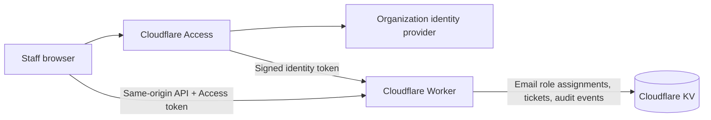
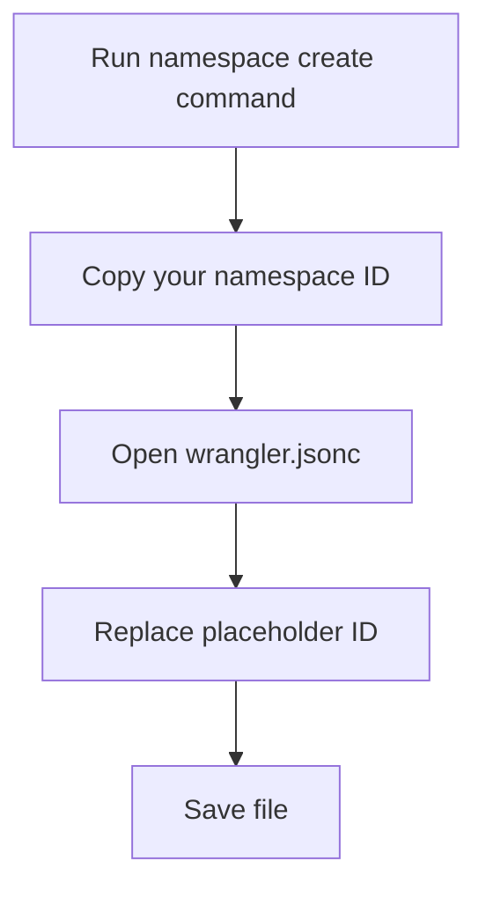
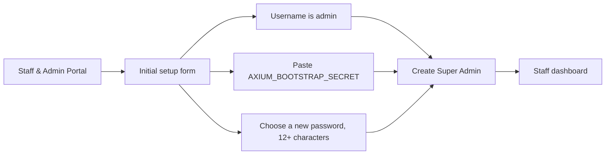

# Axium Cyber Website

The Axium Cyber public website and staff portal. Cloudflare Access provides organization SSO, a Worker validates Access identity tokens and enforces roles, and KV stores staff role assignments, tickets, settings, and audit events.

> Follow the steps in order. You will set the Access team domain, Access application audience, and KV namespace ID in `wrangler.jsonc`. Keep the bootstrap secret out of source files and chat messages.

## How It Fits Together



	The identity provider authenticates staff. Cloudflare Access issues a signed token, and the Worker validates its signature, issuer, audience, expiry, and email before looking up that email's role in KV. The browser never sends a password to this portal.

## Before You Start

- A Cloudflare account with Workers enabled
- A domain/hostname in Cloudflare for the portal (for example, `portal.example.com`)
- A supported identity provider configured in Cloudflare Zero Trust (Google, Microsoft Entra ID, Okta, or another supported provider)
- Node.js and npm installed
- A terminal opened in this project directory
- An internet connection (the site loads Tailwind CSS, Font Awesome, and Google Fonts from CDNs)

Check that Node and npm are available:

```sh
node --version
npm --version
```

Commands below use `npx wrangler`; npm will download Wrangler when needed. No API token needs to be added to this project.

## Step 1: Sign In To Cloudflare

From the project directory, run:

```sh
npx wrangler login
```

A browser window opens. Sign in to the Cloudflare account that should own this Worker and approve access. Return to the terminal and wait for Wrangler to confirm login before continuing.

## Step 2: Create The KV Namespace

Create the production namespace:

```sh
npx wrangler kv namespace create AXIUM_KV
```

Wrangler prints output similar to this (your ID will be different):

```text
Created namespace with title "axium-cyber-portal-AXIUM_KV"
Add the following to your configuration file:
{ "binding": "AXIUM_KV", "id": "0123456789abcdef0123456789abcdef" }
```

Copy the 32-character ID from your own output. Open `wrangler.jsonc` and replace only the placeholder below:

```jsonc
"kv_namespaces": [
	{
		"binding": "AXIUM_KV",
		"id": "PASTE_YOUR_REAL_NAMESPACE_ID_HERE"
	}
]
```

Do not paste the example ID above; it is illustrative only. Keep the binding name exactly `AXIUM_KV`. The Worker uses that name to access KV.



## Step 3: Add The One-Time Setup Secret

Generate a private setup key in your terminal:

```sh
openssl rand -hex 32
```

Keep the output available for the first-admin step. Do not put it in `wrangler.jsonc`, `README.md`, or `index.html`. Store it as a Cloudflare Worker secret:

```sh
npx wrangler secret put AXIUM_BOOTSTRAP_SECRET
```

When Wrangler prompts, paste the generated key and press Enter. It may not echo the value; that is expected. The secret is used only to create the first Super Admin account.

## Step 4: Check The Configuration Before Deploying

Run a dry build:

```sh
npx wrangler deploy --dry-run
```

Look for both bindings in the output:

```text
env.AXIUM_KV    KV Namespace
env.ASSETS      Assets
```

If the output shows `REPLACE_WITH_KV_NAMESPACE_ID`, go back to Step 2 and replace the placeholder. A dry run builds the Worker but does not publish it.

## Step 5: Deploy The Website And Worker

```sh
npx wrangler deploy
```

At the end, Wrangler prints the deployed URL. It normally looks like:

```text
https://axium-cyber-portal.<your-workers-subdomain>.workers.dev
```

Open the exact URL printed by Wrangler. Do not open `index.html` directly from your computer for the Cloudflare portal; the portal needs the Worker API.

## Step 6: Create The First Super Admin

At the deployed site, click **Staff & Admin Portal**. The first visit displays the initial setup form instead of a login form:



Enter the same setup key you saved in Step 3 and choose a new admin password with at least 12 characters. The username is fixed as `admin`. Click **CREATE SUPER ADMIN**; success opens the dashboard.

After you have confirmed that `admin` can sign in, remove the setup secret so it cannot be used again:

```sh
npx wrangler secret delete AXIUM_BOOTSTRAP_SECRET
```

Do not delete the KV namespace. It contains the live user and ticket data.

## Step 7: Add Staff Accounts

Sign in as `admin`, then use **Staff Identity Registry** to create staff accounts. Assign each person one of the available roles: Admin, Tech Support, Moderator, or Staff. Share their username and initial password with them privately. Staff sign in from the portal tab; the Worker validates their role on every protected API request.

The old browser-only demo accounts (`admin` / `anubis2026` and `analyst` / `cyber2026`) are not Cloudflare accounts and are not migrated. Create the real accounts through the Super Admin registry.

## Optional: Run Locally First

Local Wrangler uses a local KV emulator; it does not change the production KV namespace. Prepare a local-only secret file:

```sh
cp .dev.vars.example .dev.vars
```

Open `.dev.vars` and replace the sample value with a unique local setup key. This file is ignored by Git. Then start the local site:

```sh
npx wrangler dev
```

Open `http://localhost:8787`, choose the staff portal, and initialize the local `admin` using the key from `.dev.vars`. Local test accounts and tickets are separate from the deployed site. Stop the dev server with `Ctrl+C`.

## Troubleshooting

| What you see | What to check |
| --- | --- |
| `REPLACE_WITH_KV_NAMESPACE_ID` in Wrangler output | The ID in `wrangler.jsonc` is still the placeholder. Repeat Step 2. |
| Wrangler says you are not authenticated | Run `npx wrangler login` and approve access in the browser. |
| Setup form says setup is disabled | Confirm `AXIUM_BOOTSTRAP_SECRET` exists with `npx wrangler secret list`, then deploy again. For local development, set the value in `.dev.vars`. |
| Setup form says invalid setup key | Use the exact key generated in Step 3. It is not your Cloudflare password or your new admin password. |
| Login form appears after setup | Confirm you opened the deployed URL from the same Worker deployment and that KV is bound as `AXIUM_KV`. |
| Site loads but portal reports a connection error | Open the Wrangler-provided Worker URL, not a local `file://` page or a different Pages/Worker origin. |

## Data And Security Notes

- KV stores PBKDF2 password hashes, expiring server-side sessions, tickets, settings, and account/ticket audit events. Plaintext passwords are not stored.
- The session uses an `HttpOnly`, `Secure`, `SameSite=Strict` cookie.
- Cloudflare KV is eventually consistent, not transactional. Concurrent edits may race; it is not a good fit for regulated or high-volume ticket data. Use a transactional database such as D1 if strict consistency is required.
- Audit events are application-level history, not immutable or tamper-proof records. Add separate backups/retention controls if they are operationally important.
- The forensic scanner and terminal panels are interface demos; they do not contact real threat-intelligence or scanning services.
