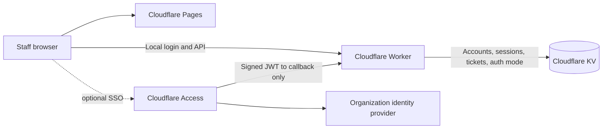
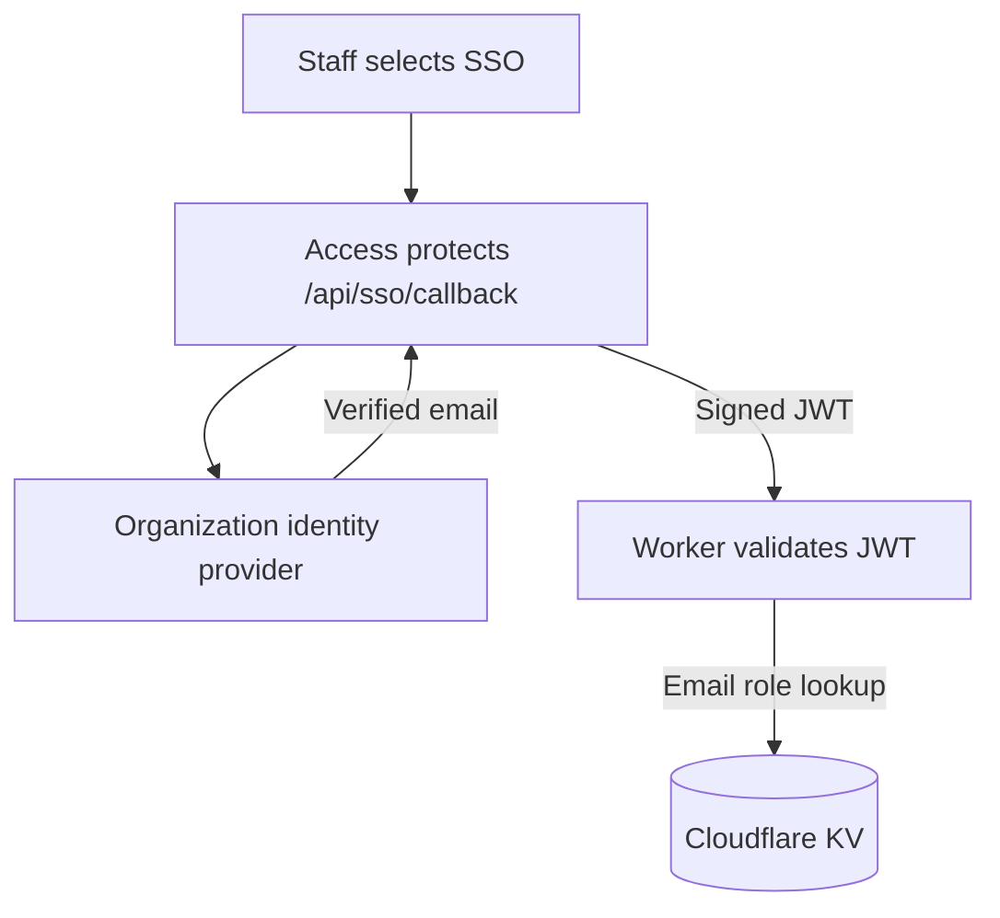
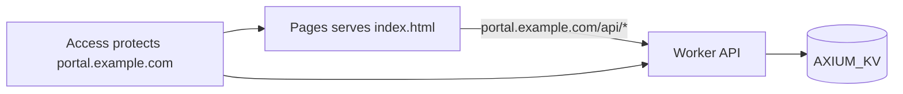
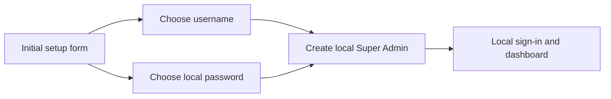

# Axium Cyber Website

The Axium Cyber public website and staff portal. Local username/password. authentication is active by default. A Super Admin can switch the portal to Cloudflare Access SSO; a second switch returns it to local authentication. KV stores accounts, auth mode, sessions, tickets, settings, and audit events.

> This guide uses the Cloudflare dashboard only. No Wrangler, PowerShell, or terminal commands are required.

## How It Fits Together

Local sign-in is the default. When SSO is activated, the Worker redirects sign-in through Cloudflare Access, validates the returned identity token, then matches the verified email to a KV account. Access protects only `/api/sso/callback`, so its edge login does not prevent the Super Admin from switching SSO off.

## Before You Start

- A Cloudflare account with Workers, Pages, KV, and Zero Trust Access available
- A domain/hostname managed by Cloudflare for the portal (for example, `portal.example.com`)
- Access to the identity provider you want staff to use (Google, Microsoft Entra ID, Okta, or another provider supported by Cloudflare)
- The project files `index.html` and `worker.mjs`
- An internet connection (the site loads Tailwind CSS, Font Awesome, and Google Fonts from CDNs)

## Step 1: Create The Pages Site

1. Sign in to the Cloudflare dashboard.
2. Open **Workers & Pages**, choose **Create application**, then choose **Pages** and the direct-upload option. Cloudflare may label this **Upload assets**.
3. On your computer, make a folder containing the site's `index.html`. Do not include `.dev.vars`, `worker.mjs`, `.git`, or any secret files in the Pages upload.
4. Give the Pages project a name such as `axium-cyber-portal`, then upload the folder and deploy it.
5. In the Pages project, open **Custom domains** and attach your Cloudflare-managed hostname, for example `portal.example.com`. Use this same hostname for Access and the API Worker.

## Step 2: Add Your Identity Provider (For Optional SSO)

In the Cloudflare dashboard, open **Zero Trust > Settings > Authentication > Login methods**. Add your organization's identity provider and finish the provider setup shown in the dashboard. Confirm the provider sends a verified email identity; that email is the key used for each staff role.

This step is optional while the portal is in local mode. The portal never collects or stores your IdP password; Cloudflare Access and your identity provider handle authentication and MFA.

## Step 3: Configure The Optional SSO Callback

1. In **Zero Trust > Access > Applications**, choose **Add an application > Self-hosted**.
2. Set the application hostname to your Pages hostname and its path to `/api/sso/callback`. Do not protect the whole hostname or `/api/*`.
3. Add an **Allow** policy for the staff emails or company email domain permitted to use SSO. Keep the allowed group narrow.
4. Save the application. On its overview/details screen, copy the **Application Audience (AUD) Tag**. Also note your team domain, which looks like `your-team.cloudflareaccess.com`.

This path-specific Access application is used only when the Super Admin activates SSO. Local username/password sign-in and the rest of the site remain outside Access.

## Step 4: Create The KV Namespace

1. In the Cloudflare dashboard, open **Storage & databases > Workers KV** (the exact menu grouping may vary).
2. Choose **Create namespace**.
3. Name it `AXIUM_KV` and create it.

You do not need to copy a namespace ID into a project file when using the dashboard. You will bind the namespace to the Worker by name in Step 5.

## Step 5: Create And Configure The API Worker

1. Open **Workers & Pages > Create application > Worker** and create a Worker, for example `axium-portal-api`.
2. Open **Edit code** / **Quick edit**. In this workspace, open `worker.mjs`, copy its complete contents, replace the starter Worker code in the dashboard editor, and choose **Deploy**.
3. Open the Worker **Settings > Bindings** (sometimes called **Variables and Secrets**).
4. Add these bindings exactly:

| Type | Variable/binding name | Value |
| --- | --- | --- |
| KV namespace | `AXIUM_KV` | Select the `AXIUM_KV` namespace created in Step 4 |
| Text variable | `ACCESS_TEAM_DOMAIN` | Optional until SSO is activated; then use your team domain, e.g. `your-team.cloudflareaccess.com` |
| Text variable | `ACCESS_AUD` | Optional until SSO is activated; then use the exact Audience Tag from Step 3 |
| Secret | `DISCORD_BOT_TOKEN` | Bot token from the Discord Developer Portal |
| Text variable | `DISCORD_APPLICATION_ID` | Discord application ID |
| Text variable | `DISCORD_PUBLIC_KEY` | Discord application public key (hex value) |
| Text variable | `DISCORD_GUILD_ID` | Discord server ID |
| Text variable | `DISCORD_SUPPORT_CATEGORY_ID` | Private category where ticket channels should be created |
| Text variable | `DISCORD_SUPPORT_ROLE_ID` | Role allowed to access ticket channels and use `/ticket-reply` |
| Secret | `TELEGRAM_BOT_TOKEN` | Token from Telegram's BotFather |
| Secret | `TELEGRAM_WEBHOOK_SECRET` | Long random value using letters, numbers, `_` or `-` |
| Text variable | `TELEGRAM_FORUM_CHAT_ID` | Numeric chat ID of the Telegram forum supergroup (often starts with `-100`) |

If you configure the optional SSO variables now, do not include `https://` or a trailing slash in `ACCESS_TEAM_DOMAIN`; `ACCESS_AUD` must match exactly. You can add these later before SSO is enabled. Save the bindings and redeploy the Worker when prompted.

#### Discord Bot Setup

1. In the Discord Developer Portal, create an application and add a bot. Copy its **Bot Token**, **Application ID**, and **Public Key** into the corresponding Worker settings above. Never paste the Bot Token into the source files or a public channel.
2. Invite the bot to your server with the `bot` and `applications.commands` scopes. Grant it **Manage Channels**, **View Channels**, **Send Messages**, and **Read Message History**. Assign the bot the support role you plan to use for ticket access.
3. Create a private category for support tickets. Set its permissions so `@everyone` cannot view it, while the support role can view and send messages. Copy the category ID and support role ID. Enable Developer Mode in Discord's Advanced settings to copy IDs.
4. The Worker creates each new ticket channel under this category, explicitly denies `@everyone`, and grants access to the configured support role. Verify that the bot is a member of that role before connecting it.

#### Telegram Bot Setup

1. In Telegram, open **@BotFather**, create a bot, and copy the bot token into the `TELEGRAM_BOT_TOKEN` Worker secret.
2. Create a Telegram supergroup for support, enable **Topics** in the group's settings, and add the bot as an administrator with permission to manage topics and send messages.
3. Find the group's numeric chat ID using an ID utility you trust, then remove that utility bot from the group. Telegram supergroup IDs commonly start with `-100`. Enter the ID as `TELEGRAM_FORUM_CHAT_ID`.
4. Generate a separate long webhook secret using your password manager. Use only letters, numbers, `_`, and `-`; save it as `TELEGRAM_WEBHOOK_SECRET` in Worker secrets.

#### Connect The Bots

After saving the bindings, open the staff portal, sign in as Super Admin, and choose **Connect Team Messaging** in **Super Admin Master Controls**. The Worker registers the Discord `/ticket-reply` command and Telegram webhook. Only tickets created after the integrations are connected automatically receive a Discord channel and Telegram topic; existing tickets are not backfilled.

When a new support ticket is created, the Worker creates one private Discord channel inside the configured category and one Telegram topic in the forum supergroup. Staff can reply in the Telegram topic directly. In Discord, use `/ticket-reply` in that ticket's channel, provide the ticket ID shown there, and enter the reply. Replies from either platform are saved as ticket notes and forwarded to the other platform. Telegram webhook updates and Discord interactions are signature/secret checked and deduplicated.

The Access application must protect only `/api/sso/callback`. Leave `/api/telegram/webhook` and `/api/discord/interactions` reachable by their providers; the Worker validates Telegram's webhook secret and Discord's Ed25519 interaction signature itself.

5. Open **Settings > Triggers > Routes** (or **Domains & Routes**) for the Worker. Add the route `portal.example.com/api/*` and select the Cloudflare zone that owns the hostname. Do not route the whole hostname to this API Worker: Pages must continue to serve `/` and `index.html`.

The `/api/*` route sends API requests to the Worker. Other paths remain served by Pages on the same hostname, so the browser can use same-origin requests and Cloudflare Access identity headers.

## Step 6: Verify Dashboard Settings

Check all of the following before first sign-in:

- Pages custom domain is `portal.example.com` (or your chosen hostname).
- The Access Self-hosted application protects only `portal.example.com/api/sso/callback`, not the whole hostname.
- The Worker route is `portal.example.com/api/*`, not `portal.example.com/*`.
- Worker KV binding is named exactly `AXIUM_KV` and points to your namespace.
- `ACCESS_TEAM_DOMAIN` and `ACCESS_AUD` match the Access team and application.

## Step 7: Create The First Super Admin (Local Mode)

Open `https://portal.example.com` (replace this with your hostname). Local authentication is active by default. Until the first account is created, the site displays the one-time setup form. Anyone who can reach the site during this period can claim the first Super Admin account, so restrict access to the hostname while provisioning.

Enter the administrator's username and a strong local password with at least 12 characters. Click **CREATE SUPER ADMIN**. This creates the first KV account and signs you in, and disables bootstrap for subsequent visitors. The initial Super Admin is local-only; SSO cannot be enabled until the account has an SSO email identity. Keep the `AXIUM_KV` binding and namespace; they contain live portal data.

## Step 8: Assign Staff Roles

Sign in as the Super Admin. In **Staff Identity Registry**, add a username, exact SSO email, and local password for each account, then assign Super Admin, Admin, Tech Support, Moderator, or Staff. Grant Super Admin only to trusted administrators; this role has full portal control. Only an existing Super Admin can create accounts or assign this role, and Super Admin accounts are protected from deletion. Passwords are required even if you expect to use SSO so the Super Admin can switch the portal back to local mode later. Staff may use their local credentials while local mode is active.

The old browser-only demo accounts (`admin` / `anubis2026` and `analyst` / `cyber2026`) are not Cloudflare accounts and will not work. Create accounts in the registry.

## Step 9: Turn SSO On Or Off

Before turning SSO on, make sure the Access app protects only `/api/sso/callback`, its Allow policy includes the staff identities, the Super Admin account has an SSO email identity, and the Worker has `ACCESS_TEAM_DOMAIN` and `ACCESS_AUD` set. Sign in as Super Admin and use **Enable SSO** in **Super Admin Master Controls**. The current session ends and the portal redirects to Cloudflare Access. Staff then sign in with their IdP account; the Access email must match the email on their portal account.

To turn SSO off, sign in as Super Admin using SSO, choose **Disable SSO**, and confirm. The session ends and local username/password sign-in becomes active again. The Access application may remain configured because only its callback path is protected; it will not gate normal portal use in local mode.

## Troubleshooting

| What you see | What to check |
| --- | --- |
| Local sign-in is not visible | Check that the Super Admin has not activated SSO. If SSO is active, choose **Disable SSO** after signing in through Access. |
| Access sign-in page does not appear after enabling SSO | Confirm the Access application protects only `portal.example.com/api/sso/callback`, your IdP is enabled, and the Super Admin selected **Enable SSO**. |
| Worker says Access is not configured | In Worker settings, set `ACCESS_TEAM_DOMAIN` to your team domain without `https://`, and set `ACCESS_AUD` to the exact Access application Audience Tag. |
| Access token is rejected | Check the team domain, Audience Tag, callback path, and that the Access app protects the callback on the same hostname as the portal. |
| SSO works but portal says the identity has no role | Sign in locally as Super Admin (or use another provisioned Super Admin), then add the exact IdP email to Staff Identity Registry. |
| A staff user cannot switch back to local mode | Every account needs a local password. The registry requires one when adding accounts so both modes remain available. |
| Public page loads but API returns 404 | Confirm the Worker route is `portal.example.com/api/*` and points to the API Worker. |
| API returns a Pages HTML page instead of JSON | Check that the Worker API route takes precedence for `/api/*`, while Pages serves the rest of the hostname. |

## Data And Security Notes

- Local account passwords are stored as PBKDF2 hashes, never plaintext. The Worker issues HttpOnly, Secure, SameSite cookies backed by mode-tagged KV sessions.
- In SSO mode, Cloudflare Access authenticates the user at the protected callback. The Worker verifies the token signature, issuer, audience, expiry, and email, then creates a portal session from the matching KV account.
- KV stores users, password hashes, sessions, auth mode, tickets, settings, and account/ticket audit events.
- Cloudflare Access protects only the SSO callback, not the whole website. Local mode can therefore remain available until the Super Admin activates SSO.
- Cloudflare KV is eventually consistent, not transactional. Concurrent edits may race; it is not a good fit for regulated or high-volume ticket data. Use a transactional database such as D1 if strict consistency is required.
- Audit events are application-level history, not immutable or tamper-proof records. Add separate backups/retention controls if they are operationally important.
- The forensic scanner and terminal panels are interface demos; they do not contact real threat-intelligence or scanning services.
